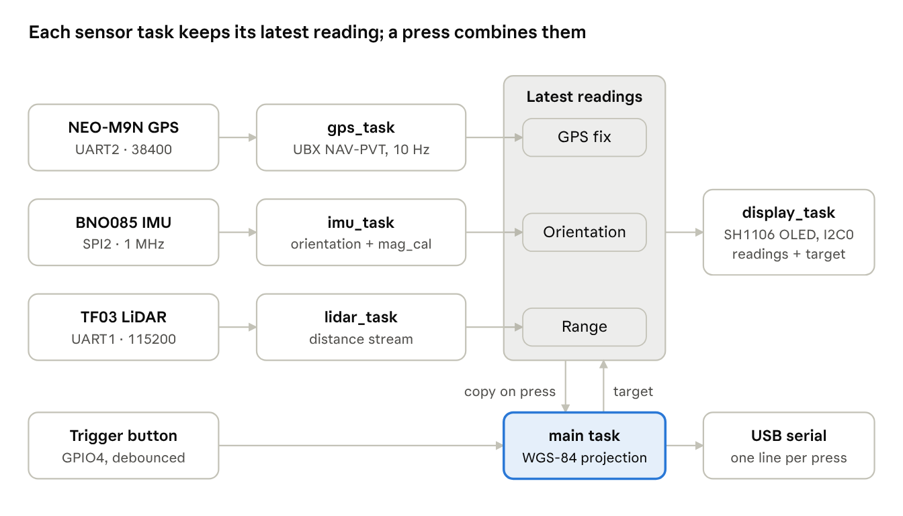

# PING Software and Systems Specification

As of 19 November 2026 · Critical Design Review (CDR)

## Purpose and scope

PING locates a distant object: the user aims the device, presses a button, and the firmware reports the object's latitude, longitude and altitude. It combines the device's own GPS position, the compass bearing and elevation from an IMU, and the range from a LiDAR.

This specification covers the Rust firmware in `src/` of the PINGCapstone repository, the version that runs on the hardware. It describes the platforms, architecture, dependencies, data storage and operating needs as of the CDR.

## Software platforms

The firmware is bare-metal Rust (`no_std`, no operating system) on an ESP32-S3, with Embassy's async executor running one task per sensor.

| Layer | Platform | Version | Role |
| --- | --- | --- | --- |
| Target hardware | Espressif ESP32-S3 (ESP32-S3-DevKitC-1-N8R8) | 8 MB flash, 8 MB PSRAM | Dual-core Xtensa LX7 microcontroller, run at maximum CPU clock |
| Language | Rust, edition 2024 | 1.88 or later | All firmware code |
| Compiler toolchain | `esp` Rust toolchain installed by espup | Target `xtensa-esp32s3-none-elf` | Compiles Rust for the Xtensa core; builds `core` and `alloc` from source |
| Hardware abstraction | esp-hal | 1.1 | Drivers for GPIO, UART, SPI, I2C, timers and USB serial |
| Runtime / scheduler | esp-rtos with Embassy (embassy-executor, embassy-time) | 0.3 / 0.10 / 0.5 | Async task executor and timers; replaces an RTOS |
| Bootloader | esp-bootloader-esp-idf | 0.5 | Standard ESP-IDF second-stage bootloader and app descriptor |
| Flash, debug, logging | probe-rs over the S3's built-in USB-JTAG | current | Flashes the board, streams RTT log output, debugger |
| Host development OS | Linux, macOS or Windows | any | Builds with `cargo`; Linux needs probe-rs udev rules |

Release builds use `opt-level = "s"`, fat LTO and one codegen unit to keep the image small, and keep full debug information.

## System architecture

Three sensor tasks and a display task run beside the main task on Embassy's executor. Each sensor task owns its bus, restarts its sensor after silence, and overwrites one shared slot with its newest reading and arrival time. On a button press, the main task copies the three slots, rejects stale readings, and walks the LiDAR range out from the GPS position along the IMU's bearing and elevation on the WGS-84 ellipsoid.

The main task also writes the result back as the last target, which the display shows for 10 s. Shared slots are guarded by a critical section, so a press never reads a half-written reading.

| Module (`src/`) | Responsibility |
| --- | --- |
| `bin/main.rs` | Start-up, the four tasks, button handling, staleness checks, output |
| `constants.rs` | Pin map and every fixed setting, including calibration |
| `neo_m9n.rs` | GPS driver: UBX configuration (RAM and BBR), NAV-PVT decoding |
| `bno085.rs`, `bno085/` | IMU driver: SHTP packets over SPI, SH-2 reports and commands |
| `tf03.rs`, `tf03/` | LiDAR driver and frame parser |
| `mag_cal.rs` | Hard/soft-iron correction and compass heading from the game rotation vector |
| `geo.rs` | Bearing and elevation from orientation; range projection on WGS-84 |
| `ssd1306.rs` | SH1106/SSD1306 text display driver |
| `bin/*` (8 others) | Calibration (`imu_cal`, `heading_cal`), sensor demos and diagnostics |

## Dependencies

The firmware depends on 19 Rust crates from crates.io, four development tools and five hardware parts. Crate versions are pinned in `Cargo.toml` and locked in `Cargo.lock`. The sensor and display drivers are written in this project, because no published crate supports these parts on this async, `no_std` target.

### Rust crates

| Crate | Version | Used for |
| --- | --- | --- |
| esp-hal | ~1.1.0 | Peripheral drivers: GPIO, UART, SPI, I2C, USB serial, timers |
| esp-rtos | 0.3.0 | Starts Embassy on the ESP32-S3; heap and radio integration |
| esp-bootloader-esp-idf | 0.5.0 | Bootloader app descriptor |
| esp-alloc | 0.10.0 | Heap allocator for formatted text and Wi-Fi |
| esp-radio | 0.18.0 | Wi-Fi controller (initialised, reserved for a future web page) |
| embassy-executor | 0.10.0 | Async tasks |
| embassy-time | 0.5.0 | Timers, timeouts, timestamps on readings |
| embassy-net | 0.9.1 | Network stack (reserved for the future web page) |
| smoltcp | 0.13.0 | TCP/IP under embassy-net |
| embedded-hal | 1.0.0 | Blocking pin traits used by the BNO085 SPI transport |
| embedded-hal-async | 1.0.0 | Async SPI and I2C traits the drivers are written against |
| embedded-io, embedded-io-async | 0.7 | Async UART read/write traits for the GPS and LiDAR drivers |
| ublox | 0.10.0 | UBX framing, checksums and message decoding for the GPS |
| libm | 0.2.16 | Trigonometry and square roots (not in `core`) for geometry and compass |
| embedded-graphics | 0.8.2 | Font and text rendering for the OLED |
| critical-section | 1.2.0 | Safe sharing of the latest readings between tasks and interrupts |
| static_cell | 2.1.1 | Statically allocated objects handed to tasks |
| rtt-target | 0.6.2 | Diagnostic log output over the debug probe |

### Development tools

| Tool | Purpose |
| --- | --- |
| espup | Installs the `esp` Rust toolchain with Xtensa support |
| cargo (with `build-std`) | Builds the firmware and every binary |
| probe-rs | Flashes, runs and debugs the firmware; shows RTT logs |
| clippy, rustfmt | Lints (stack frames capped at 1 KiB) and formatting |

### Hardware the software drives

| Part | Interface | Driver (in `src/`) |
| --- | --- | --- |
| u-blox NEO-M9N GPS (SparkFun GPS-15733) | UART2, 38400 baud, UBX protocol | `neo_m9n.rs` |
| CEVA BNO085 IMU (Adafruit breakout) | SPI2 mode 3, 1 MHz, SHTP / SH-2 protocol | `bno085.rs`, `bno085/` |
| Benewake TF03-100 LiDAR (5–24 V UART/CAN version) | UART1, 115200 baud | `tf03.rs`, `tf03/` |
| SH1106 128×64 OLED | I2C0, 400 kHz, address 0x3C | `ssd1306.rs` |
| Trigger push button | GPIO4, internal pull-up | `bin/main.rs` |

## Data storage requirements

The firmware keeps no database or log files and writes nothing to the ESP32's flash at run time. Settings and calibration are compiled into the image; readings live in RAM only until the next reading replaces them. The only data that persists across power cycles sits inside the GPS and IMU themselves.

| Data | Where it is stored | Size / lifetime | How it changes |
| --- | --- | --- | --- |
| Firmware image and bootloader | ESP32-S3 external flash (8 MB) | Permanent until reflashed | Flashed with probe-rs |
| Pin map, bus speeds, timeouts, sensor rates | Compile-time constants in `src/constants.rs` (in flash) | Permanent until reflashed | Edit the file and rebuild |
| Magnetometer calibration (`MAG_CALIBRATION`) | Compile-time constant in `src/constants.rs` | Permanent until reflashed | Run `imu_cal`, paste its output, rebuild |
| Heading correction (`HEADING_CORRECTION_DEG`, default −4.3°) and LiDAR mounting direction (`LIDAR_BORESIGHT`) | Compile-time constants in `src/constants.rs` | Permanent until reflashed | Run `heading_cal`, paste its output, rebuild |
| Latest GPS fix, IMU orientation, LiDAR range, last target | One slot per sensor in internal RAM, each with its arrival time | Overwritten by every new reading; refused when older than 2 s (GPS) or 250 ms (IMU, LiDAR) | Written by each sensor task, read on a button press |
| Start-up hard-iron refinement | Up to 512 magnetometer readings in internal RAM | Rebuilt after every power-up | Collected while the device is handled |
| Formatted text and Wi-Fi buffers | Heap in internal RAM | 73,744 bytes | Allocated and freed at run time |
| GPS output settings (UBX only, NAV-PVT rate) | NEO-M9N RAM and battery-backed RAM (BBR) | Survive receiver restarts while its backup supply holds | Written by the firmware at start-up |
| IMU's own sensor calibration | BNO085 internal flash (Dynamic Calibration Data) | Survives power cycles | Saved by `imu_cal`; the main program does not rely on it for heading |

The 8 MB PSRAM is not used. Target coordinates are not stored: each press is sent once over USB serial and shown on the display for 10 s.

## What the software needs to function

A press produces a coordinate only when all three sensors have a fresh reading, the GPS has a fix and the LiDAR sees a return. Without one of these, the press reports which one is missing instead of a coordinate.

### Hardware and power

- ESP32-S3-DevKitC-1-N8R8, wired as in `src/constants.rs` and the PING pin map.
- A 12 V battery through fuse F1 and reverse-polarity diode D1. The TF03 runs from this line (5–24 V, up to 480 mA peak).
- A buck converter giving 5.1 V to the board's 5V pin. The board's regulator supplies 3.3 V to the GPS, IMU and display (about 0.14 A in total).
- A common ground between every part.
- The NEO-M9N's backup supply, so its settings and satellite data survive short power dips.

### Operating conditions

- **GPS fix:** a view of the sky. Positions older than 2 s are rejected.
- **IMU reports:** orientation and magnetometer readings at least every 250 ms; the IMU is restarted after 1 s of silence.
- **LiDAR return:** a target within the TF03's range that reflects enough signal; ranges older than 250 ms are rejected.
- **Magnetic environment:** away from steel structures, vehicles and other iron, which bend the compass heading.

### One-time setup before use

1. Install the toolchain: espup (then the `esp` toolchain) and probe-rs.
2. Set `LIDAR_BORESIGHT` to how the LiDAR is mounted against the IMU.
3. Run `imu_cal` and paste its `MAG_CALIBRATION` into `src/constants.rs`. Repeat whenever anything magnetic near the IMU changes.
4. Run `heading_cal` against known bearings and paste its `HEADING_CORRECTION_DEG`.
5. Build and flash the main program: `cargo run --release --bin ping_capstone`.

### At every power-up

- Turn the device through a range of directions so the firmware can refine the hard-iron offset. Until then the heading is shown but marked unreliable.

### To read the output

- The OLED shows each target for 10 s. A computer on the USB port (any serial monitor) receives one line per press; a debug probe connection shows diagnostics over RTT.

## Design changes from PDR to CDR

Six major software changes were made between the PDR design (the first complete main program, 22 September 2026) and the CDR. The same matrix is in `docs/design-change-matrix.xlsx`.

| Change ID | What changed? | How was the change identified? | Reason for the change |
| --- | --- | --- | --- |
| DC-01 | Calculated the compass heading on the ESP32 | Prototype testing | The IMU's built-in calibration couldn't be verified, so headings weren't trustworthy |
| DC-02 | Added a compass calibration routine | Follow-on from DC-01 | The new heading calculation needs a measured, quality-checked calibration |
| DC-03 | Replaced two heading offsets with one measured correction | Code review | Two offsets that are always added together can't be measured separately |
| DC-04 | Read LiDAR distances without waiting for a command reply | Bench testing | No distances were read whenever the LiDAR didn't answer a command |
| DC-05 | Kept GPS settings across receiver restarts | Bench testing | The GPS lost its settings on every restart and dropped position |
| DC-06 | Moved all settings into one constants file | Code review | Settings were duplicated across programs and drifting apart |
